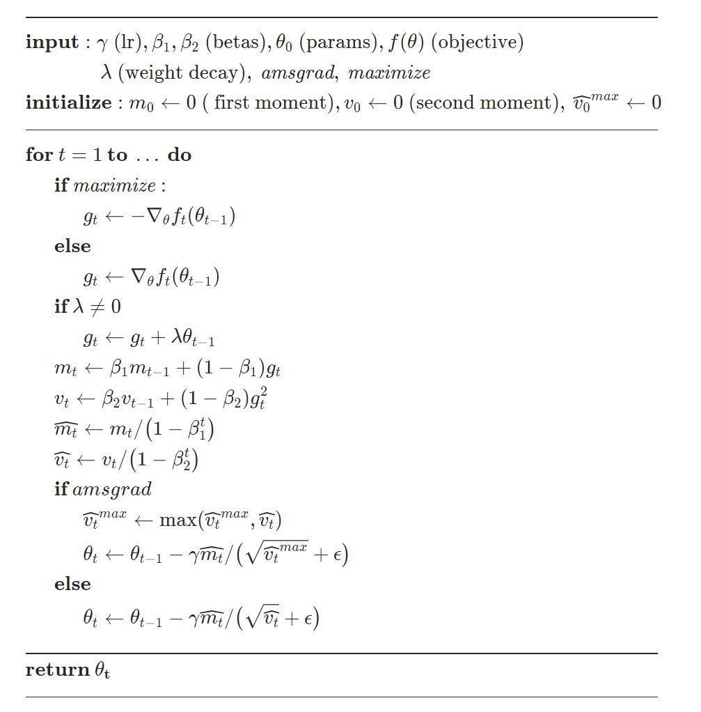
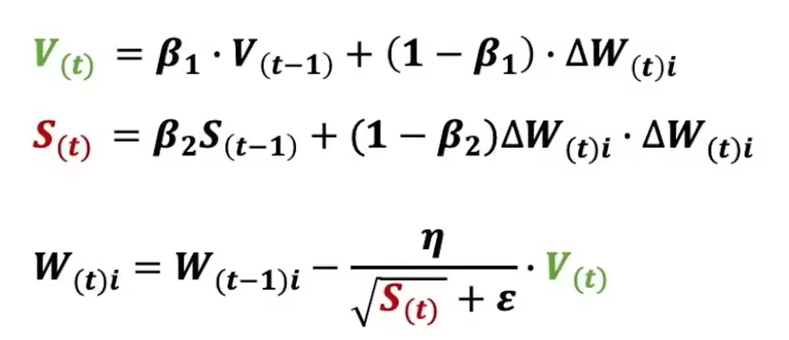

把训练时常用的几个优化算法放在一起记一下。先从梯度下降开始，再看动量和自适应学习率，最后接一下Pytorch的调用方式。

统一一下记号：$w_{t-1}$表示第$t$次更新前的参数，$g_t$表示这一步算出的梯度，$\eta_t$为学习率。下面的平方、开方、乘法和除法，作用在向量上时都按元素计算。

# 梯度下降

假设要最小化的目标为：

$$
L(w)=\frac{1}{N}\sum_{i=1}^{N}\ell_i(w)
$$

梯度为$g_t=\nabla_w L(w_{t-1})$，更新公式为：

$$
w_t=w_{t-1}-\eta_t g_t
$$

梯度表示当前位置函数增长最快的方向，因此沿负梯度方向走一小步，有机会让loss下降。这里要注意“走一小步”：学习率太大时，可能越过低点，在两边震荡，甚至发散。负梯度方向也不等于直接指向最小值的方向。

全量梯度下降每次使用全部训练数据计算梯度。数据量很大时，更新一次参数的成本就比较高。

# 随机梯度下降SGD

严格来说，SGD每次随机取一个样本计算梯度；实际训练中更常见的是mini-batch SGD，即每次取一小批样本：

$$
g_t=\frac{1}{|B_t|}\sum_{i\in B_t}\nabla_w\ell_i(w_{t-1})
$$

参数更新公式仍然是$w_t=w_{t-1}-\eta_t g_t$，变化的是梯度的计算方式。均匀采样且满足相应条件时，这个梯度可以看作全量梯度的无偏估计。

batch之间的数据不同，梯度会有波动，所以训练曲线不一定每一步都下降。batch size也会改变一轮训练里的更新次数。比较两个实验时，只看epoch可能不够，还要看总更新步数。

Pytorch中的`torch.optim.SGD`负责拿已经算好的梯度更新参数，不负责随机抽样。样本怎么分batch、是否打乱顺序，由数据加载部分决定。

```python
optimizer = torch.optim.SGD(net.parameters(), lr=0.01)
```

# 动量法

普通SGD每次主要看当前梯度。动量法会保留过去的方向信息：

$$
b_t=\mu b_{t-1}+g_t,\qquad
w_t=w_{t-1}-\eta_t b_t
$$

其中$b_0=0$，$\mu$为动量系数。连续几步方向相近时，历史梯度会累积；如果某个方向来回变化，正负项会有一部分抵消。

可以用一个比较窄的谷底理解：横向的梯度一会儿向左、一会儿向右，纵向的梯度虽然小，但可能一直向前。累积之后，两个方向的表现会不同。

也有资料写成$b_t=\mu b_{t-1}+(1-\mu)g_t$。这是另一种缩放约定，不能直接照搬同一个学习率。上面保留的是Pytorch在`dampening=0`时的常用形式；具体实现还有初始化等细节。[SGD文档](https://docs.pytorch.org/docs/stable/generated/torch.optim.SGD.html)专门说明了这些差异。

```python
optimizer = torch.optim.SGD(
    net.parameters(), lr=0.01, momentum=0.9
)
```

# Nesterov

Nesterov动量常被解释成“先沿着已有动量看一下前面的位置，再用那里的梯度修正方向”。看公式时需要注意，不同资料可能使用不同的参数坐标和动量定义。

如果直接对照Pytorch，在忽略weight decay、设置`dampening=0`时，可以记为：

$$
b_t=\mu b_{t-1}+g_t
$$

$$
w_t=w_{t-1}-\eta_t(g_t+\mu b_t)
$$

和前一节相比，真正用于更新的方向从$b_t$变成了$g_t+\mu b_t$。这里的$g_t$仍然由当前参数计算，不需要在代码里手动把参数移动一次再求梯度。[关于初始化和动量的论文](https://proceedings.mlr.press/v28/sutskever13.html)里有相关讨论。

```python
optimizer = torch.optim.SGD(
    net.parameters(), lr=0.01, momentum=0.9, nesterov=True
)
```

# AdaGrad

前面的方法主要改变更新方向。AdaGrad会按每个参数过去的梯度大小，调整它的有效步长：

$$
s_t=s_{t-1}+g_t\odot g_t
$$

$$
w_t=w_{t-1}-\frac{\eta_t}{\sqrt{s_t}+\epsilon}\odot g_t
$$

其中$s_0=0$，$\epsilon$用于避免分母为0。经常出现大梯度的坐标，累积量$s_t$会更大，后面的更新就会受到更多缩放。这也是它和稀疏特征联系比较紧的原因之一。[AdaGrad原论文](https://jmlr.org/papers/v12/duchi11a.html)从自适应梯度方法的角度进行了推导。

问题是$s_t$一直累加，不会忘记很早以前的梯度。长时间训练后，某些坐标的有效步长可能变得很小。

```python
optimizer = torch.optim.Adagrad(net.parameters(), lr=0.01)
```

# RMSprop

RMSprop把梯度平方的累加，换成指数移动平均：

$$
s_t=\alpha s_{t-1}+(1-\alpha)(g_t\odot g_t)
$$

$$
w_t=w_{t-1}-\frac{\eta_t}{\sqrt{s_t}+\epsilon}\odot g_t
$$

这样旧梯度的影响会逐渐衰减，分母不再像AdaGrad那样一直累加。$\alpha$越大，保留的历史越长。

上面写的是不带动量、`centered=False`的基本形式。Pytorch还提供了带动量以及centered的变体，查看实现时要先看清楚参数。[RMSprop文档](https://docs.pytorch.org/docs/stable/generated/torch.optim.RMSprop.html)中的公式也把这些分支列了出来。

```python
optimizer = torch.optim.RMSprop(
    net.parameters(), lr=0.001, alpha=0.99
)
```

# Adam

Adam同时保留梯度的一阶矩估计和二阶原始矩估计：

$$
m_t=\beta_1m_{t-1}+(1-\beta_1)g_t
$$

$$
v_t=\beta_2v_{t-1}+(1-\beta_2)(g_t\odot g_t)
$$

由于$m_0=v_0=0$，前几步的估计会偏向0，因此还要做偏差修正：

$$
\hat m_t=\frac{m_t}{1-\beta_1^t},\qquad
\hat v_t=\frac{v_t}{1-\beta_2^t}
$$

最后更新：

$$
w_t=w_{t-1}-\eta_t\frac{\hat m_t}{\sqrt{\hat v_t}+\epsilon}
$$

分子保留方向信息，分母根据每个坐标的梯度尺度做缩放。这里$v_t$是梯度平方的移动平均，不是减去均值之后的方差。[Adam原论文](https://arxiv.org/abs/1412.6980)给出了完整算法。

```python
optimizer = torch.optim.Adam(
    net.parameters(), lr=0.001, betas=(0.9, 0.999), eps=1e-8
)
```

自适应学习率也不代表不用设置学习率，$\eta_t$仍然在控制整体步长。另外，如果要加weight decay，需要区分把L2项加进梯度和AdamW的解耦权重衰减，这两种更新一般不等价。比较实验时要把这个设置也记下来。[Adam文档](https://docs.pytorch.org/docs/stable/generated/torch.optim.Adam.html)和[AdamW文档](https://docs.pytorch.org/docs/stable/generated/torch.optim.AdamW.html)分别列出了对应算法。

# 学习率调整策略StepLR

优化器决定这一步怎么更新，scheduler决定学习率什么时候改变。StepLR每经过`step_size`次调度，将学习率乘以`gamma`。

下面约定每个epoch结束时调用一次`scheduler.step()`。这样`step_size=10`就是每10个epoch衰减一次。如果把调用放在每个batch后面，计数单位就变成batch了。

用一个简单的线性回归接起来：

```python
import torch
from torch import nn


torch.manual_seed(7)
x = torch.linspace(-1, 1, 128).reshape(-1, 1)
y = 3 * x + 0.5
net = nn.Linear(1, 1)

optimizer = torch.optim.SGD(
    net.parameters(), lr=0.1, momentum=0.9
)
scheduler = torch.optim.lr_scheduler.StepLR(
    optimizer, step_size=10, gamma=0.1
)
loss_fn = nn.MSELoss()

for epoch in range(30):
    net.train()
    used_lr = optimizer.param_groups[0]["lr"]

    optimizer.zero_grad()
    loss = loss_fn(net(x), y)
    loss.backward()
    optimizer.step()

    # 在本轮参数更新之后，设置下一轮使用的学习率
    scheduler.step()
    print(epoch + 1, used_lr, float(loss.detach()))
```

按这里的调用顺序，第1到10轮使用0.1，第11到20轮使用0.01，第21到30轮使用0.001。`scheduler.step()`放在`optimizer.step()`之后，和[Pytorch文档](https://docs.pytorch.org/docs/stable/optim.html#how-to-adjust-learning-rate)中的调用方式一致。

还有两点比较容易混在一起：

- `zero_grad()`清空的是梯度，不会清掉优化器已经保存的动量或Adam状态。不要在每个epoch里重新创建优化器，否则这些历史信息也会丢掉。
- `StepLR`只按次数调整，不会看验证集loss。如果希望根据验证指标调整，需要另外选择对应的调度器。

先把每个方法到底保存了什么状态、这些状态怎么参与下一步更新弄清楚，再比较效果会容易一些。不同优化器直接使用同一个学习率，并不能保证是公平的比较。

## 参考

- [Pytorch torch.optim](https://docs.pytorch.org/docs/stable/optim.html)
- [Pytorch SGD](https://docs.pytorch.org/docs/stable/generated/torch.optim.SGD.html)
- [On the importance of initialization and momentum in deep learning](https://proceedings.mlr.press/v28/sutskever13.html)
- [Adaptive Subgradient Methods for Online Learning and Stochastic Optimization](https://jmlr.org/papers/v12/duchi11a.html)
- [Neural Networks for Machine Learning Lecture 6](https://www.cs.toronto.edu/~tijmen/csc321/slides/lecture_slides_lec6.pdf)
- [Pytorch RMSprop](https://docs.pytorch.org/docs/stable/generated/torch.optim.RMSprop.html)
- [Adam A Method for Stochastic Optimization](https://arxiv.org/abs/1412.6980)
- [Pytorch StepLR](https://docs.pytorch.org/docs/stable/generated/torch.optim.lr_scheduler.StepLR.html)


## 原始简记与配图

<h1 id="梯度下降">梯度下降</h1>
<p><span class="math inline">\(w_{t+1} = w_t-\eta \bigtriangledown
w_t\)</span></p>
<h1 id="随机梯度下降sgd">随机梯度下降SGD</h1>
<h1 id="动量法">动量法</h1>
<h1 id="nesterov">Nesterov</h1>
<h1 id="adagrad">AdaGrad</h1>
<h1 id="rmsprop">RMSprop</h1>
<h1 id="adam">Adam</h1>
<p>https://pytorch.org/docs/stable/generated/torch.optim.Adam.html  </p>
<h1 id="学习率调整策略steplr">学习率调整策略StepLR</h1>
